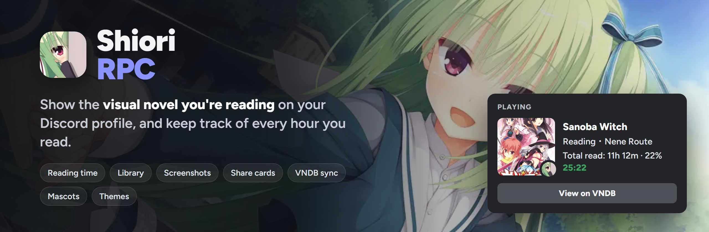
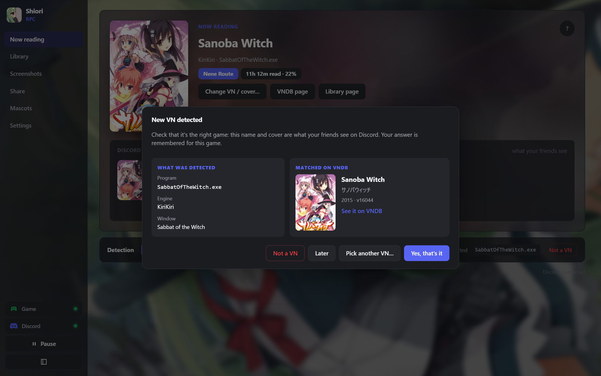
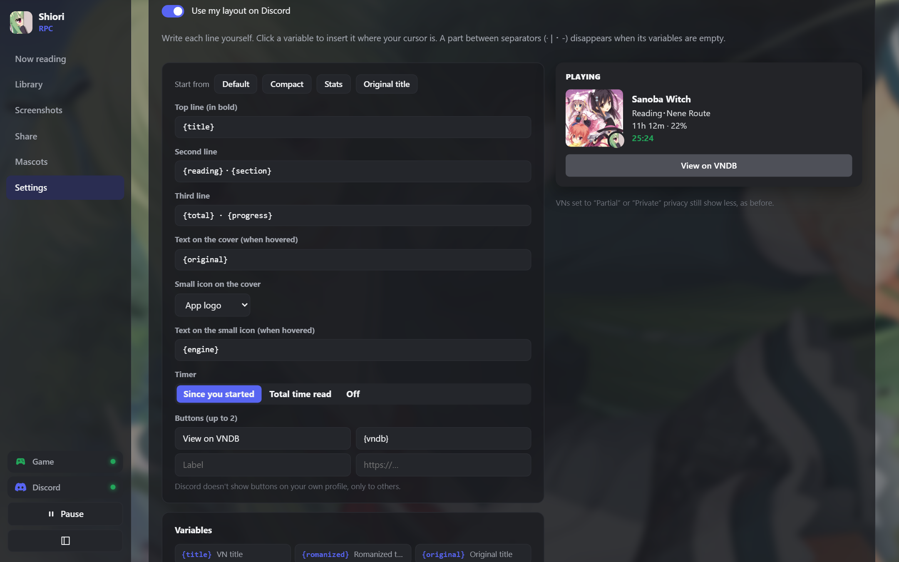

<p align="center"></p>

<p align="center">
  <a href="https://github.com/lennmoe/shiori/releases/latest"></a>
  <a href="https://vnrpc-docs.vercel.app/"></a>
  <a href="https://discord.gg/cDTUQFq4Hn"></a>
</p>

<p align="center">
  <a href="https://github.com/lennmoe/shiori/releases"></a>
  
  
  
</p>

<p align="center">
  A small tray app that reads the VN's window title, so most engines work with <b>no setup</b>.<br>
  One light <code>.exe</code>, nothing else to install.
</p>

<p align="center"><sub>Formerly <b>Visual Novel RPC</b>.</sub></p>

<br>

<p align="center"></p>

## Highlights

<table>
  <tr>
    <td width="50%" valign="top">
      
      <h3>Finds your VN by itself</h3>
      Ren'Py, KiriKiri, SiglusEngine, BGI, Unity, emulators… The first time, it asks you to check the VNDB match, so friends never see the wrong name or cover.
    </td>
    <td width="50%" valign="top">
      
      <h3>Your own Discord status <sup>beta</sup></h3>
      Write each line with <code>{title}</code>, <code>{section}</code>, <code>{progress}</code>… Add text on the cover, a small icon, a timer and buttons, and see it live.
    </td>
  </tr>
  <tr>
    <td width="50%" valign="top">
      
      <h3>Every hour you read</h3>
      A Library of every VN with time read, day by day history, reading calendar and streaks, and your progress against the VNDB length.
    </td>
    <td width="50%" valign="top">
      
      <h3>Share your reading</h3>
      “My week / month in visual novels” as an image to paste on Discord, and a yearly recap on <a href="https://wrapped.maia.moe">wrapped.maia.moe</a>.
    </td>
  </tr>
  <tr>
    <td width="50%" valign="top">
      
      <h3>Screenshots in one key</h3>
      Capture the game window while you read, then browse them by VN or by date.
    </td>
    <td width="50%" valign="top">
      
      <h3>Desktop mascots</h3>
      Characters on your desktop who talk about what you read, with personalities, your own lines and voices.
    </td>
  </tr>
</table>

## Get started

1. **Download** [`shiori_setup.exe`](https://github.com/lennmoe/shiori/releases/latest) and run it. No admin rights needed, and you can uninstall it from Windows settings. Prefer no install? Take `shiori.exe`, it runs from any folder.
2. **Open Discord** (the desktop app), with *Settings → Activity Privacy → Share your detected activities* on.
3. **Start a VN.** That's it: it shows up on your profile.

The app updates itself and shows what changed after each update. Full guide: [Install](https://vnrpc-docs.vercel.app/install/) · [Troubleshooting](https://vnrpc-docs.vercel.app/troubleshooting/)

## Everything it does

| | |
|---|---|
| **Discord** | Chapter, route or ending read from the window title · original or romanized title · privacy per VN (everything, no chapter, just “Visual Novel”, or nothing) · NSFW covers stay hidden unless you allow them |
| **Reading** | Time read per VN and per day · calendar and streaks · progress against the VNDB length · status and rating · description and characters from VNDB |
| **VNDB** | List sync · random pick from your wishlist when you can't decide |
| **Playing** | Play button and desktop shortcuts, through Steam, Locale Emulator or NTLEA |
| **Make it yours** | 16 themes or your own colors · your own background image · 7 languages: English, French, Spanish, Portuguese (Brazil), Russian, Japanese, Vietnamese |

<details>
<summary><b>More screenshots</b></summary>

<br>

**A VN's page**: stats, progress, status, launcher and reading chart.


**Characters**, straight from VNDB.


**Screenshots by date.**


**Random pick** from your VNDB wishlist.


**Themes** and **background image**.


**7 languages.**


</details>

## Community

Questions, bug reports and ideas: join the **[Discord server](https://discord.gg/cDTUQFq4Hn)**, or [open an issue](https://github.com/lennmoe/shiori/issues).

Everything is explained in the **[documentation](https://vnrpc-docs.vercel.app/)**: [Discord status](https://vnrpc-docs.vercel.app/discord-status/), [chapters & routes](https://vnrpc-docs.vercel.app/chapters/), [covers](https://vnrpc-docs.vercel.app/covers/), [Library](https://vnrpc-docs.vercel.app/library/), [screenshots](https://vnrpc-docs.vercel.app/screenshots/), [share card](https://vnrpc-docs.vercel.app/share/), [VNDB](https://vnrpc-docs.vercel.app/vndb/), [Japanese locale](https://vnrpc-docs.vercel.app/japanese-locale/), [themes](https://vnrpc-docs.vercel.app/themes/), [mascots](https://vnrpc-docs.vercel.app/mascot/), [all settings](https://vnrpc-docs.vercel.app/settings/), [your data](https://vnrpc-docs.vercel.app/data/).

## Where your data is

Everything is in `%APPDATA%\moe.lenn.shiori\`: `config.yaml` (settings), `games\<title>.yaml` (one file per VN, safe to edit), `mascots\`, `backgrounds\` and `cache\`. Screenshots go to `Pictures\Shiori RPC\<VN title>\` unless you pick another folder. If the app crashes, `crash.log` and `crash.dmp` are saved there too. See [Your data & backups](https://vnrpc-docs.vercel.app/data/).

## Translate it

Each language lives in a single file, `ui/locales/<code>.json`: the interface, the Discord status and the mascot lines. Want to add yours? Copy `en.json`, translate it, and say hi on the [Discord](https://discord.gg/cDTUQFq4Hn).

<details>
<summary><b>For developers</b></summary>

<br>

Written in Rust with [Tauri](https://tauri.app). Needs [Rust](https://rustup.rs), the MSVC build tools and Node.js, on Windows 10 or 11 (WebView2 is already part of Windows).

```
npm install
npm run dev
```

Build the `.exe` and the installer (close the app first). The result is `src-tauri\target\release\shiori.exe`, with its symbols in `shiori.pdb` (keep that file for each release to read crash reports with `tools/symbolize`), and the installer in `src-tauri\target\release\bundle\nsis\`.

```
npm run build
```

For a release, rename the installer to `shiori_setup.exe` and upload `shiori.exe` **first**: versions before 2.1.10 update from the first `.exe` they find in the release.

Tests and formatting:

```
cd src-tauri
cargo test
cargo fmt
cd ..
npx prettier --write "ui/**/*.{js,css,html}"
```

The engine is in Rust (`src-tauri/src`). The interface is plain HTML, CSS and JavaScript modules (`ui/`), with no build step.

| `src-tauri/src` | |
|---|---|
| `engine.rs`, `state.rs` | the loop: detection, reading time, idle mode, Discord |
| `engines.rs`, `emulators.rs`, `title_parser.rs` | engine and emulator detection, title cleaning, chapter and route parsing |
| `config.rs`, `vndb.rs`, `vndb_list.rs`, `steam.rs` | Library files, VNDB search, covers, characters, list and wishlist |
| `discord.rs`, `presence.rs` | Rich Presence over Discord's IPC pipe, your own status layout |
| `screenshots.rs`, `capture.rs`, `hotkey.rs`, `sound.rs` | capture key, window capture, shutter sound |
| `mascot.rs`, `personalities.rs`, `ui_windows.rs`, `tray.rs` | desktop mascots, speech balloon, toast, main window, tray |
| `launcher.rs`, `backup.rs`, `updater.rs`, `autostart.rs` | Play (Steam, Locale Emulator, NTLEA), export and import, updates, startup |
| `lang.rs`, `crash.rs` | languages, crash reports |
| `images.rs`, `clipboard.rs`, `shell.rs`, `winapi.rs` | thumbnails, clipboard, shortcuts, Explorer, Win32 |
| `commands/` | what the windows can call, by feature |

| `ui/js` | |
|---|---|
| `pages/` | one file per page: home, cover, library, game, wishlist, screenshots, share, mascots, settings (with the presence builder), what's new |
| `components/` | chart, calendar, share card, yearly recap, new VN check, welcome, theme tab, Play, update… |
| `labs/` | features in beta, each one can be turned off in Settings → Beta |
| `popups/` | the mascot, its speech balloon, the screenshot toast |
| `app.js`, `router.js`, `store.js`, `ui.js`, `i18n.js` | startup, navigation, shared state, small widgets, translations |

</details>

## Credits

- **[VNDB](https://vndb.org)**: visual novel data, covers, characters, lengths and list sync come from the VNDB API. Covers and game screenshots in these images come from VNDB and belong to their publishers.
- **Flags**: the language flags come from [osu-resources](https://github.com/ppy/osu-resources) by ppy, licensed under [CC BY-NC 4.0](https://creativecommons.org/licenses/by-nc/4.0/).
