# Visual Novel RPC

Show the visual novel you're reading on your **Discord profile**: the game, your current chapter or route, the time read and its cover.

<p align="center">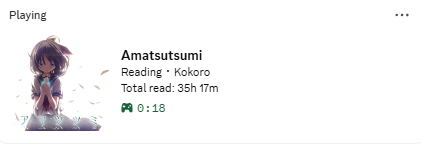</p>

<p align="center">
  <a href="https://github.com/lennmoe/vnrpc/releases/latest"><b>Download</b></a> ·
  <a href="https://vnrpc-docs.vercel.app/"><b>Documentation</b></a> ·
  <a href="https://vnrpc-docs.vercel.app/troubleshooting/">Troubleshooting</a> ·
  <a href="https://discord.gg/cDTUQFq4Hn">Discord</a>
</p>

<p align="center">
  <a href="https://github.com/lennmoe/vnrpc/releases">
    
  </a>
</p>

<p align="center">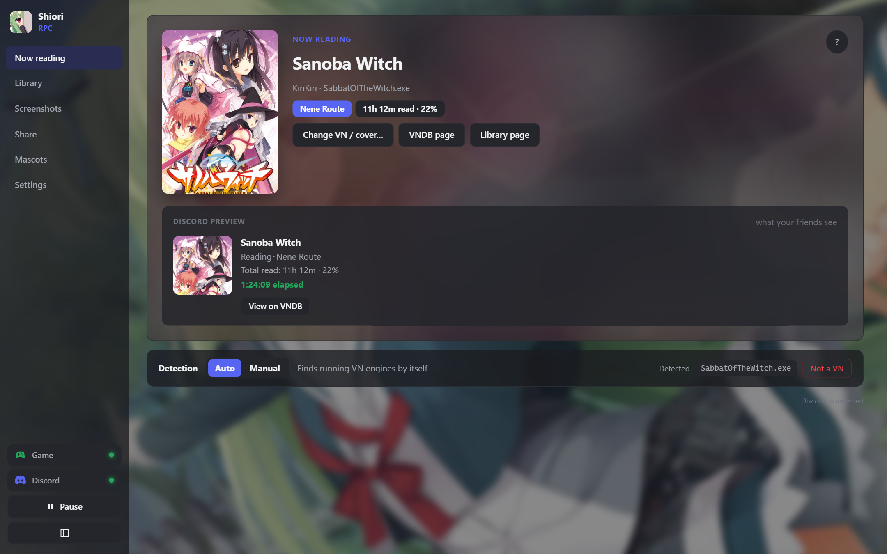</p>

A small Windows tray app, written in Rust with [Tauri](https://tauri.app). It reads the title of the VN's window, so most engines work without any setup. One light `.exe` (about 10 MB), nothing else to install. Available in 7 languages.

## Features

- **Finds the VN by itself** (Ren'Py, KiriKiri, SiglusEngine, BGI, emulators…), or you pick the window by hand.
- **Shows where you are**: prologue, chapter, route or ending, read from the window title.
- **Tracks time read** for each VN, with a day-by-day history, a reading calendar with streaks, and your progress against the average length on VNDB.
- **Library** of every VN you've read, with a page for each one: status, rating, chart, description, characters and screenshots.
- **Screenshots** of the game window with one key, in a gallery sorted by VN or by date.
- **Share card**: "My week / my month in visual novels", copied as an image to paste on Discord.
- **VNDB list sync**, and a **random pick from your wishlist** when you can't decide what to read next.
- **Play button and desktop shortcuts**, through Steam, Locale Emulator or NTLEA.
- **Privacy per game**: everything, no chapter, just "Visual Novel", or nothing. NSFW covers stay blurred unless you allow them.
- **Make it yours**: 16 themes or your own colors, and your own **background image**.
- **Desktop mascots** with personalities, your own lines and voices.
- **7 languages**: English, French, Spanish, Portuguese (Brazil), Russian, Japanese, Vietnamese.

## Screenshots

### Library

Every VN you've read and your reading days over the year. [Docs](https://vnrpc-docs.vercel.app/library/)

<p align="center">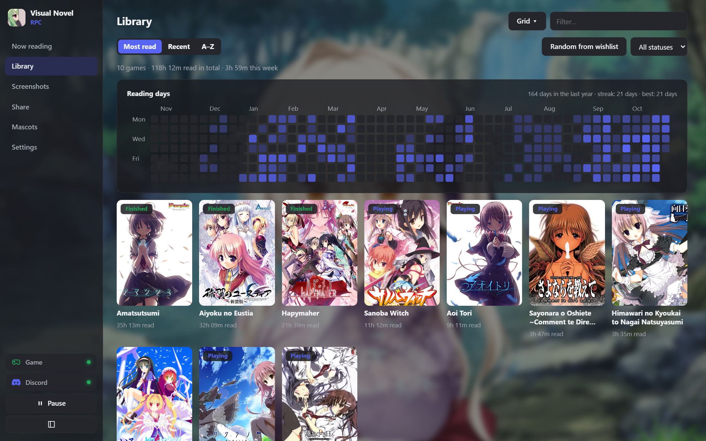</p>

### A VN's page

Time read, progress against the VNDB length, status, rating, how to launch it, and its reading chart.

<p align="center">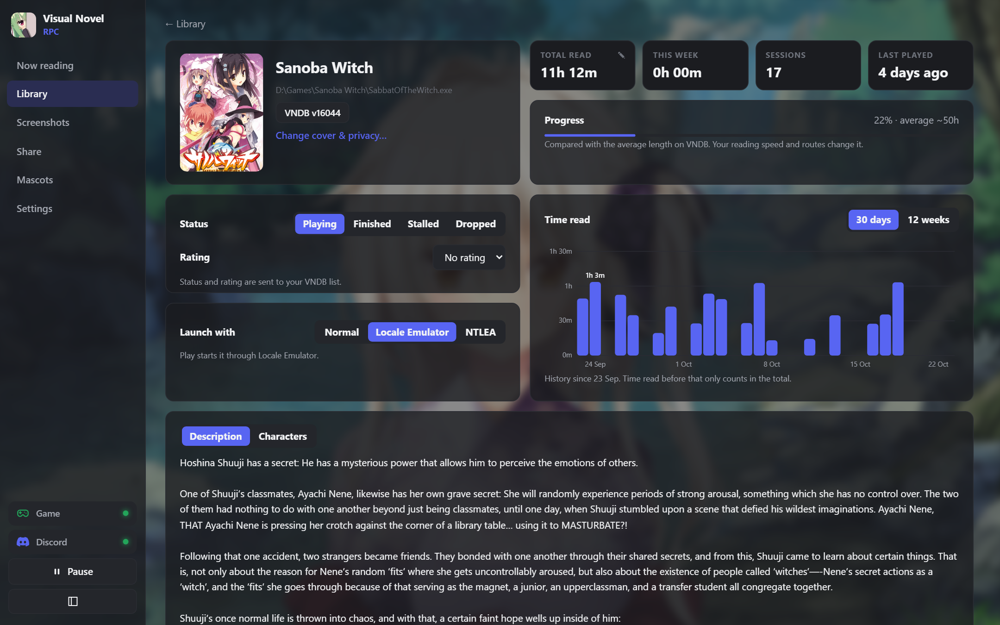</p>

Its description and characters, straight from VNDB.

<p align="center">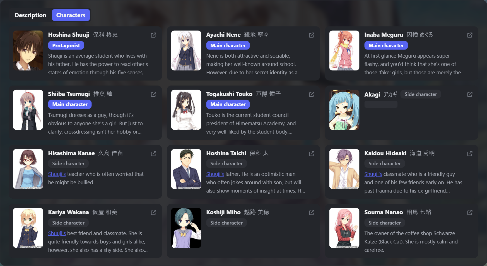</p>

### Screenshots

One key in game, then browse, copy or delete them. [Docs](https://vnrpc-docs.vercel.app/screenshots/)

<p align="center">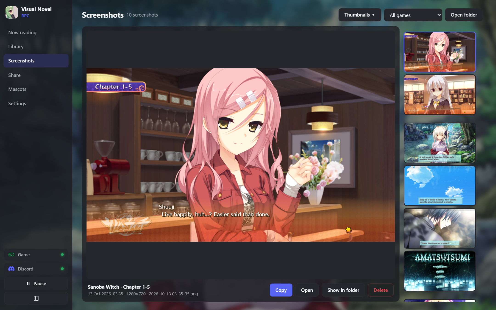</p>
<p align="center">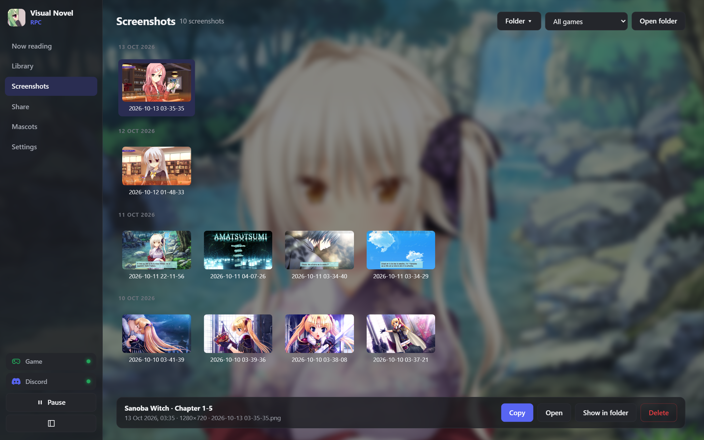</p>

### Share card

Your week or month in visual novels, ready to paste on Discord. [Docs](https://vnrpc-docs.vercel.app/share/)

<p align="center">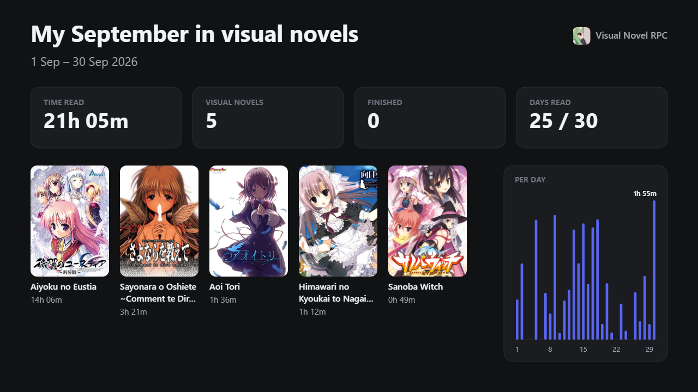</p>

### Random pick

Can't decide? Draw a VN from your VNDB wishlist. [Docs](https://vnrpc-docs.vercel.app/vndb/)

<p align="center">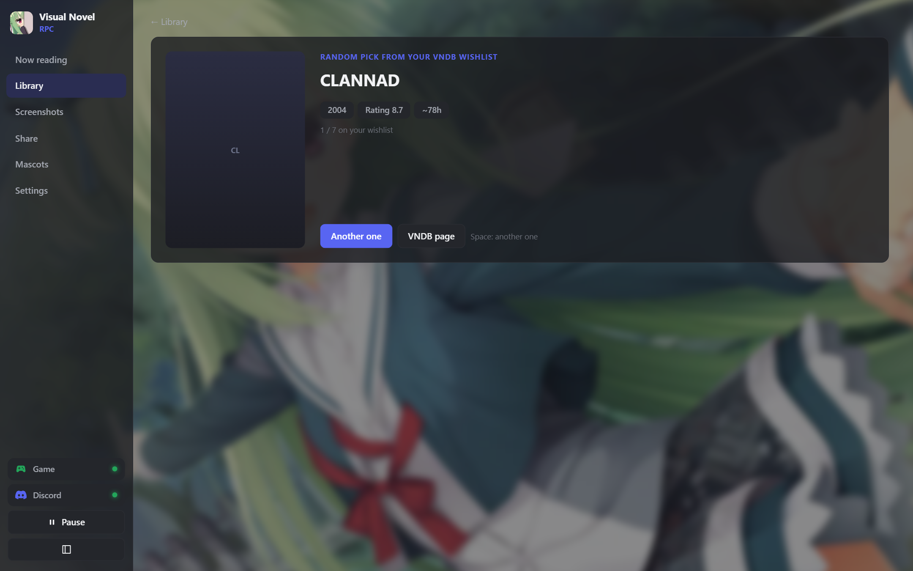</p>

### Themes and background

Pick a theme with a click, make your own colors, and put any picture behind the app. [Docs](https://vnrpc-docs.vercel.app/themes/)

<p align="center">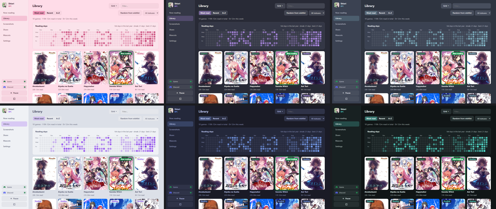</p>
<p align="center">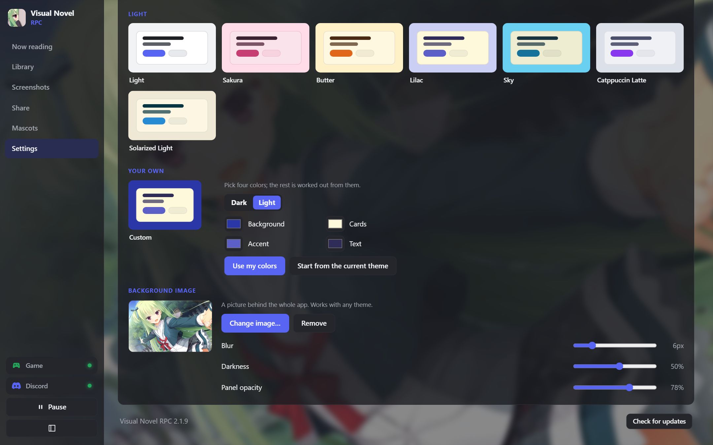</p>

### Languages

<p align="center">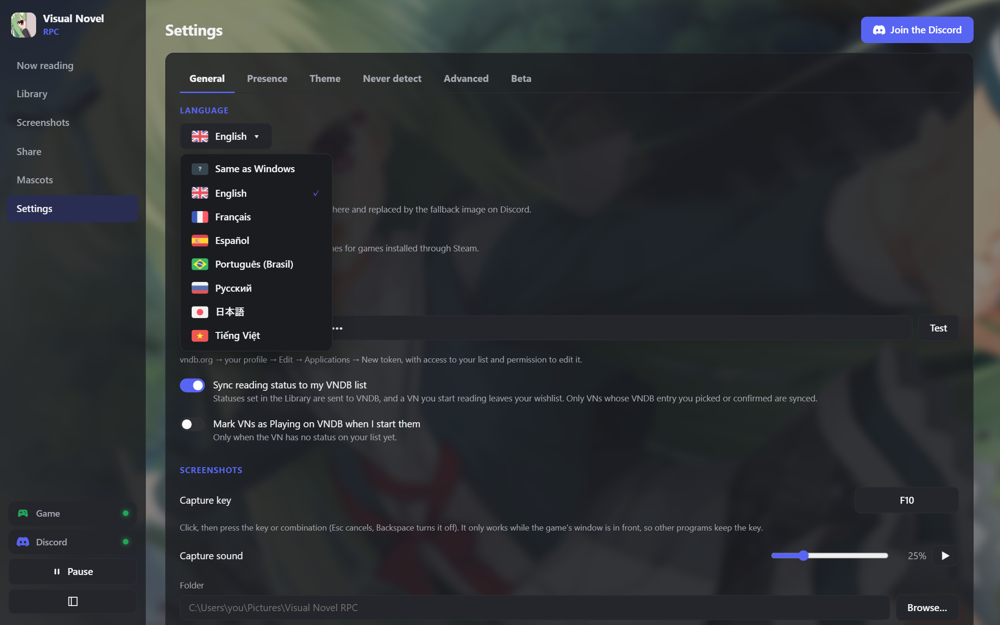</p>

### Desktop mascots

Characters who stand on your desktop and talk about what you read. Pick a personality or write their lines, add voices, or make them click-through while you play. [Docs](https://vnrpc-docs.vercel.app/mascot/)

<p align="center">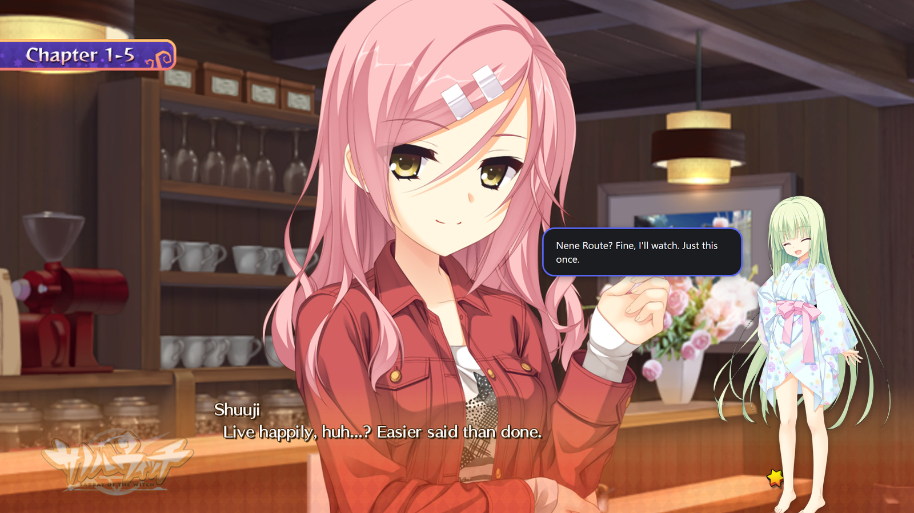</p>

## Install

1. Download [`vnrpc.exe`](https://github.com/lennmoe/vnrpc/releases/latest) and run it.
2. Keep the Discord desktop app open, with **Settings → Activity Privacy → Share your detected activities** turned on.

The app updates itself: it checks for a new release when it starts and shows what changed after an update. Full guide: [Install](https://vnrpc-docs.vercel.app/install/).

## Community

Questions, bug reports and ideas: join the **[Discord server](https://discord.gg/cDTUQFq4Hn)**, or [open an issue](https://github.com/lennmoe/vnrpc/issues).

## Documentation

Everything is explained on **[vnrpc-docs.vercel.app](https://vnrpc-docs.vercel.app/)**:

- [Discord status & privacy](https://vnrpc-docs.vercel.app/discord-status/) and [chapters & routes](https://vnrpc-docs.vercel.app/chapters/)
- [Covers](https://vnrpc-docs.vercel.app/covers/), [Library](https://vnrpc-docs.vercel.app/library/), [Screenshots](https://vnrpc-docs.vercel.app/screenshots/), [Share card](https://vnrpc-docs.vercel.app/share/)
- [VNDB list & wishlist](https://vnrpc-docs.vercel.app/vndb/), [Japanese locale](https://vnrpc-docs.vercel.app/japanese-locale/), [Themes](https://vnrpc-docs.vercel.app/themes/), [Desktop mascot](https://vnrpc-docs.vercel.app/mascot/)
- [All settings](https://vnrpc-docs.vercel.app/settings/), [Your data & backups](https://vnrpc-docs.vercel.app/data/), [Troubleshooting](https://vnrpc-docs.vercel.app/troubleshooting/)

## Run from source

Needs [Rust](https://rustup.rs), the MSVC build tools and Node.js, on Windows 10 or 11 (WebView2 is already part of Windows).

```
npm install
npm run dev
```

Build the `.exe` (close the app first). The result is `src-tauri\target\release\vnrpc.exe`, with its symbols in `vnrpc.pdb`: keep that file for each release to read crash reports with `tools/symbolize`.

```
npm run build
```

Tests and formatting:

```
cd src-tauri
cargo test
cargo fmt
cd ..
npx prettier --write "ui/**/*.{js,css,html}"
```

### Where things are

The engine is in Rust (`src-tauri/src`). The interface is plain HTML, CSS and JavaScript modules (`ui/`), with no build step.

| `src-tauri/src` | |
|---|---|
| `engine.rs`, `state.rs` | the loop: detection, reading time, idle mode, Discord |
| `engines.rs`, `emulators.rs`, `title_parser.rs` | engine and emulator detection, title cleaning, chapter and route parsing |
| `config.rs`, `vndb.rs`, `vndb_list.rs`, `steam.rs` | Library files, VNDB search, covers, characters, list and wishlist |
| `discord.rs` | Rich Presence over Discord's IPC pipe |
| `screenshots.rs`, `capture.rs`, `hotkey.rs`, `sound.rs` | capture key, window capture, shutter sound |
| `mascot.rs`, `personalities.rs`, `ui_windows.rs`, `tray.rs` | desktop mascots, speech balloon, toast, main window, tray |
| `launcher.rs`, `backup.rs`, `updater.rs`, `autostart.rs` | Play (Steam, Locale Emulator, NTLEA), export and import, updates, startup |
| `lang.rs`, `crash.rs` | languages, crash reports |
| `images.rs`, `clipboard.rs`, `shell.rs`, `winapi.rs` | thumbnails, clipboard, shortcuts, Explorer, Win32 |
| `commands/` | what the windows can call, by feature |

| `ui/js` | |
|---|---|
| `pages/` | one file per page: home, cover, library, game, wishlist, screenshots, share, mascots, settings, what's new |
| `components/` | chart, calendar, share card, theme tab, language picker, Play, update… |
| `labs/` | features being tried out, each one can be turned off in Settings |
| `popups/` | the mascot, its speech balloon, the screenshot toast |
| `app.js`, `router.js`, `store.js`, `ui.js`, `i18n.js` | startup, navigation, shared state, small widgets, translations |

## Languages

Each language lives in a single file, `ui/locales/<code>.json`: the interface, the Discord status and the mascot lines. Want to add yours? Copy `en.json`, translate it, and say hi on the [Discord](https://discord.gg/cDTUQFq4Hn).

## Where your data is

Everything is in `%APPDATA%\moe.lenn.vnrpc-tauri\`: `config.yaml` (settings), `games\<title>.yaml` (one file per VN, safe to edit), `mascots\`, `backgrounds\` and `cache\`. Screenshots go to `Pictures\Visual Novel RPC\<VN title>\` unless you pick another folder. If the app crashes, `crash.log` and `crash.dmp` are saved there too. See [Your data & backups](https://vnrpc-docs.vercel.app/data/).

## Credits

- **[VNDB](https://vndb.org)**: visual novel data, covers, characters, lengths and list sync come from the VNDB API. Covers and game screenshots in these images come from VNDB and belong to their publishers.
- **Flags**: the language flags come from [osu-resources](https://github.com/ppy/osu-resources) by ppy, licensed under [CC BY-NC 4.0](https://creativecommons.org/licenses/by-nc/4.0/).
